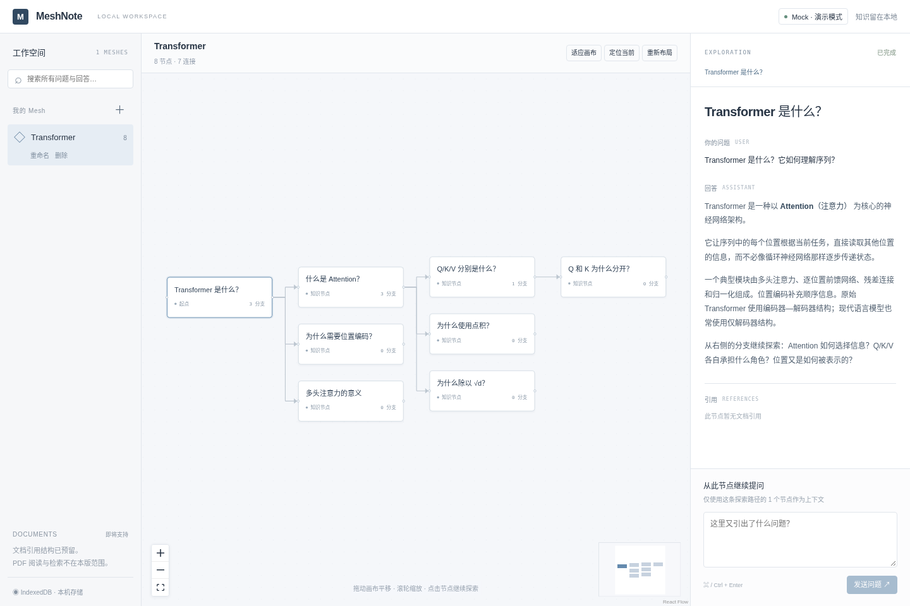

# MeshNote

**Graph First · Conversation inside Graph**

MeshNote 是桌面优先的 AI 学习与文档理解工具。每个 Mesh 是一个主题，每个节点是一组完整问答；从任意历史节点继续提问，让探索过程自然生长成图，而不是一条越来越长的聊天记录。



## 快速开始

需要 **Bun 1.4+**、**Node.js 22.12+**（推荐当前 Node 24 LTS，Vite 与 Playwright 仍需 Node）和现代桌面浏览器。

```bash
bun install
bun run dev
```

打开 **http://127.0.0.1:5173**。此命令同时启动 Vite 和本地 Node 模型代理（8787）。无需 API key：默认使用明确标注的 **Mock 演示模式**，首次打开即包含 Transformer 的 8 个示例节点。

1. 点击图上的「什么是 Attention？」查看完整问答。
2. 在右侧「从此节点继续提问」发送问题。新节点立即出现，然后回答逐步输出。
3. 回到同一个历史节点再次提问，形成另一个分支；上下文只包含根节点到这个节点的路径，不混入兄弟分支。
4. 左侧搜索标题、问题或回答。点击结果会打开对应 Mesh、选中并定位节点。
5. 刷新后，Mesh、问答、连接和节点坐标仍然保留。

## 已实现

- Mesh 创建、重命名、确认删除、打开与列表。
- 空 Mesh 的首个问题成为 root；任意历史节点可创建 branch。
- React Flow + ELK 左→右布局，平移、缩放、fit、MiniMap、拖动节点、定位当前节点。
- 紧凑节点卡片、分支数量、生成状态、祖先路径高亮与可点击 breadcrumb。
- **增量放置保留原节点坐标**；streaming 和标题更新不重新布局。只有「重新布局」会整体整理图。
- 流式问答、短标题生成及失败 fallback、取消、错误展示和部分回答保留。
- 跨 Mesh 关键词搜索（标题/问题/回答）与定位。
- IndexedDB 原子保存；刷新恢复，意外中断会明确标记，不假装回答已完成。
- Mock 与 OpenAI-compatible 模型适配器；服务端密钥、本机代理。
- Document / DocumentChunk / NodeReference 模型及 Repository 查询预留。

## 配置真实模型

```bash
cp .env.example .env
```

编辑 `.env`：

```dotenv
MESHNOTE_LLM_BASE_URL=https://api.openai.com/v1
MESHNOTE_LLM_API_KEY=你的密钥
MESHNOTE_LLM_MODEL=gpt-4o-mini
```

重启 `bun run dev`。`baseUrl` 是供应商前缀（通常含 `/v1`），不要包含 `/chat/completions`。可以指向支持文本 Chat Completions 和 SSE 的兼容服务。

**不要把密钥命名为 `VITE_*`。** 密钥只留在 Node 环境，不进入浏览器 bundle 或 IndexedDB。没有 key 使用 Mock；真实模型发生错误时不会悄悄切换成演示回答。详见 [LLM 配置与协议](docs/LLM.md)。

真实模型会收到所选探索路径的问答内容。启用前请确认供应商的数据政策；「本地存储」不等于真实模型调用离线。

## 构建与本机运行

```bash
bun run build
bun run start
```

打开 **http://127.0.0.1:8787**。Node 服务同时托管 `dist` 和 `/api`，无需单独 Vite。

这是**个人本机 MVP**：代理只绑定 loopback，并检查 Host/Origin；没有公网认证或用户系统。不要通过反向代理直接暴露到公网。开发默认端口为 5173 / 8787。

## 数据与限制

- 数据保存在当前浏览器、当前 origin 的 IndexedDB。`localhost` 与 `127.0.0.1`、5173 与 8787 是不同存储空间；请固定使用同一地址。
- 首次初始化只写入一次 Demo。删除所有 Mesh 后刷新不会重新生成 Demo。
- 删除不可撤销。清理浏览器站点数据会删除知识内容；目前没有导入导出或备份功能，不建议作为重要研究资料的唯一副本。
- 同一应用实例一次生成一个回答，可在生成期间浏览其他节点。当前没有跨标签页并发编辑保障，请只用一个标签页编辑。
- 本期默认 branch 为单根树，但 Edge 是一等图实体；ContextBuilder 遇到多父路径、循环或坏引用会报错，不随意选择上下文。
- 增量布局保持位置，可能不如全局重排紧凑。ELK 是较大的独立懒加载 bundle；千节点性能、布局 worker 化、折叠导航尚未做基准验证。
- 不包含 PDF 上传/阅读器/RAG、语义搜索、账户、云同步、协作、移动端或 Electron 安装包。文档结构只是预留。

## 测试

```bash
bun run test             # 领域、存储、流协议、代理、布局测试
bun run build            # TypeScript + production bundle
bunx playwright install chromium
bun run test:e2e         # Chromium 真实用户流程，自动启动/停止开发服务
# 构建后验证生产静态服务：
bun run test:e2e -- --config=playwright.production.config.ts
```

Linux 缺少浏览器系统依赖时，可按 Playwright 提示安装依赖。端到端测试需要默认端口空闲，并强制使用无 key 模式；真实模型路径用受控协议响应验证，不消耗供应商额度。

## 架构导航

```text
src/domain/                 通用图与服务契约
src/services/application/   业务生命周期与持久化队列
src/services/context/       祖先路径上下文
src/services/layout/        ELK 与稳定增量布局
src/services/llm/           Provider 契约适配、Mock、代理客户端
src/services/search/        关键词检索
src/repositories/           查询接口、IndexedDB / Memory 实现
src/features/               Graph 与节点详情
src/stores/                 Zustand 视图导航
server/                     本机 HTTP 边界、真实模型 Provider
```

- [技术选型与图引擎比较](docs/TECH_STACK.md)
- [架构、领域模型与扩展边界](docs/ARCHITECTURE.md)
- [后续路线](docs/ROADMAP.md)
- [MVP 验证记录](docs/VALIDATION.md)
